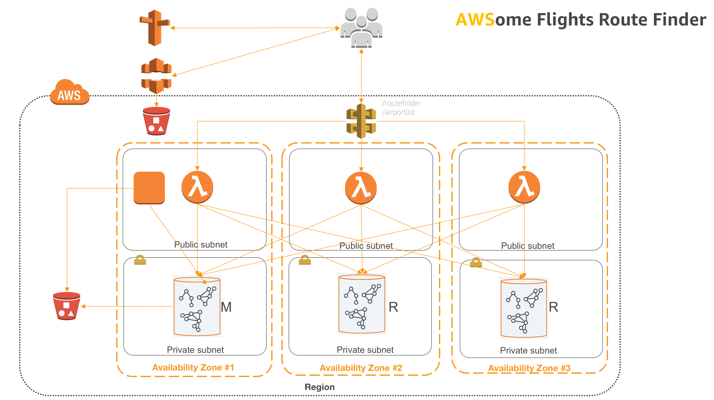
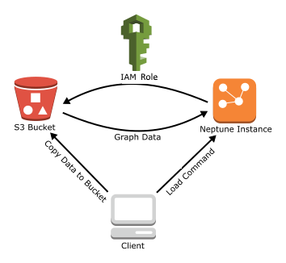
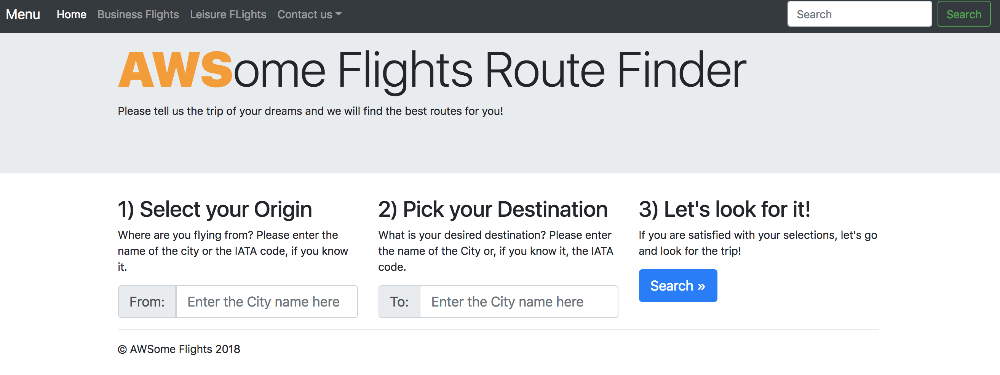

# Amazon Neptune - Graph Databases

## Introduction

### What is a Graph Database

Amazon Neptune is a fast, reliable, fully-managed graph database service that makes it easy to build and run applications that work with highly connected datasets. SQL queries for highly connected data are complex and hard to tune for performance. Instead, with Amazon Neptune you can use open and popular graph query languages to execute powerful queries that are easy to write and perform well on connected data. The core of Neptune is a purpose-built, high-performance graph database engine optimized for storing billions of relationships and querying the graph with milliseconds latency. You can use Neptune for graph use cases such as recommendation engines, fraud detection, knowledge graphs, drug discovery, and network security. Amazon Neptune is fully managed and handles the time-consuming tasks such as provisioning, patching, backup, recovery, failure detection and repair. You pay a simple monthly charge for each Amazon Neptune database instance you use. There are no upfront costs or long-term commitments required.

### Use cases

These are just a few examples of cases where Amazon Neptune shines and fits perfectly over othe DB solutions:

* Fraud Detection
* Recommendation Engines
* Knowledge Graphs
* Life Sciences
* Network / IT Operations

### Neptune features

* Fully managed
* Multi-AZ
* Highly available, with up to 15 read replicas
* Storage auto scales up to 64TB using SSD
* Automatic backups
* Failover in less than 30 secs
* ACID compliant with immediate consistency.
* Supports Resource Description Framework (RDF) and Tinkerpop
* Supports Tinkerpop Gremlin & SPARQL
* 99.99% or more availability
* It stores 6 copies of your data across 3 Availability Zones
* Data encryption in transit and at rest via KMS

(as of Nov'19)

More info at the [AWS Amazon Neptune page](https://aws.amazon.com/neptune/)


### Limits

Amazon Neptune is an RDS service and shares some of the standard limits of RDS. Check the [Amazon Neptune Limits documentation](https://docs.aws.amazon.com/neptune/latest/userguide/limits.html) for more information. Keep these in mind:

* **Console Access Required** : Creating and modifying Amazon Neptune instances and clusters must be done through the AWS Management Console.
* **VPC Required** : Amazon Neptune is a virtual private cloud (VPC)–only service. Additionally, instances do not allow access from outside the VPC.
* **Availability Zones and DB Subnet Groups** : Amazon Neptune requires a DB subnet group for each cluster that has subnets in at least two supported Availability Zones. We recommend using three or more subnets in different Availability Zones. 


## What are we going to do

We are going to build a web application that will give us the flights available between any two airports in the wold. For this, we will use a Neptune backend that has all the flights, routes and airports in the world, a simple API service via Amazon API Gateway and AWS Lambda to query the database and a simple static frontend in HTML5/javascript using bootstrap(TM) as the frontend. Also, we will use a Amazon S3 bucket to learn how do to a bulk load of data into neptune.


## Setting things up

In order to run the solution, we will create a Neptune cluster in a private subnet group of an Amazon VPC, some AWS Lambda functions on the (public subnets of the) VPC and a couple of  S3 buckets. If you don't have a VPC with public and private subnets (and the corresponding subnets and subnet groups, create them now)

**Requirements**

1. An AWS Account
2. An IAM user able to :
   1. Create & manage an Amazon EC2 instance.
   2. Create & manage a Neptune instances.
   3. Create, manage and assign IAM policies and roles.
   4. Create & manage VPCs, subnets, IGWs, Routes, Security Groups.
   5. Create & manage S3 buckets.
   6. Create & manage Amazon CloudFront distributions.
3. The [AWS CLI](https://aws.amazon.com/cli/) properly installed.


### Region

For this exercise, we will use the Ireland Region (**eu-west-1**), make sure you create our services in this region.

### VPC

In order to run Neptune clusters, we need to  have ready at least one private subnet group. For the purpose of this exercise we need a VPC with at least 2 private and 2 public subnets. As a reference, we will create a VPC with 6 subnets, 3 public and 3 private with a /20 addressing and a private subnet group. On the public subnets we will run our Lambda functions and on the private, the Neptune instances. If you already have a VPC and a SubnetGroup of private subnets, you can skip this section.

Create a VPC and keep note of its VpcId, we'll use it in the following commands
```bash
REGION="eu-west-1" 
aws ec2 create-vpc --cidr-block 10.0.0.0/16 --region ${REGION}
```

Let's add a tag to it to know this is the Neptune VPC
```bash
aws ec2 create-tags --resources <VPC_ID> --tags Key=Name,Value="VPC-Neptune"
```

Create subnets (replace VPC-ID with the Id of the VPC you have just created). Keep note of the SubnetIds created.
```bash
aws ec2 create-subnet --vpc-id <VPC_ID> --cidr-block 10.0.0.0/20  --availability-zone eu-west-1a

aws ec2 create-subnet --vpc-id <VPC_ID> --cidr-block 10.0.16.0/20 --availability-zone eu-west-1b

aws ec2 create-subnet --vpc-id <VPC_ID> --cidr-block 10.0.32.0/20 --availability-zone eu-west-1c

aws ec2 create-subnet --vpc-id <VPC_ID> --cidr-block 10.0.48.0/20 --availability-zone eu-west-1a

aws ec2 create-subnet --vpc-id <VPC_ID> --cidr-block 10.0.64.0/20 --availability-zone eu-west-1b

aws ec2 create-subnet --vpc-id <VPC_ID> --cidr-block 10.0.80.0/20 --availability-zone eu-west-1c
```

Create an internet gateway so our public subnets can access the internet.
```bash
aws ec2 create-internet-gateway

aws ec2 attach-internet-gateway --vpc-id <VPC_ID> --internet-gateway-id <IGW-ID>
```

Create a route table for the gateway.
```bash
aws ec2 create-route-table --vpc-id <VPC_ID>

aws ec2 create-route --route-table-id <RTB-ID> --destination-cidr-block 0.0.0.0/0 --gateway-id <IGW-ID>
```

Associate the route to the public subnets. For each public subnet created previously (3 of the 6 created), associate it to the route:
```bash
aws ec2 associate-route-table  --subnet-id <SUBNET-ID> --route-table-id <RTB-ID>
```

Create a Subnet Group for the Neptune cluster using our private subnets. This is a RDS feature so you can create it via the RDS AWS Console.
```bash
aws rds create-db-subnet-group \
--db-subnet-group-name "Neptune Subnet Group" \
--db-subnet-group-description "Private Subnet Group for the Neptune Cluster" \
--subnet-ids <SUBNET-ID1> <SUBNET-ID2> <SUBNET-ID3>
```

### S3 buckets

We will use S3 to host the frontend of our application and also to store the data that will be loaded into the neptune cluster. We will also create a VPC S3 endpoint.

#### Bucket for the web app

Create an S3 bucket that will be used to host the static web application. 
```bash
aws s3 mb s3://your-unique-name.neptune-workshop-2018-tech-summit
```

Create a CloudFront disitrbution for the S3 bucket and keep note of the value of DomainName
```bash
aws cloudfront create-distribution \
  --origin-domain-name your-unique-name.neptune-workshop-2018-tech-summit.s3.amazonaws.com \
  --default-root-object index.html
```

Make sure you **secure the bucket** by [restricting Access to Amazon S3 Content by Using an Origin Access Identity](https://docs.aws.amazon.com/AmazonCloudFront/latest/DeveloperGuide/private-content-restricting-access-to-s3.html)


Optionally, see if it works:
```bash
echo "howdy!" > /tmp/index.html
aws s3 cp /tmp/index.html s3://your-unique-name.neptune-workshop-2018-tech-summit/

#(wait a bit...)

curl <your-CF-distribution-domain-name>
```

#### Bucket to bulk load data into Neptune

Create a second bucket to store and load content to Neptune 
```bash
aws s3 mb s3://your-unique-name-data.neptune-workshop-2018-tech-summit
```

#### S3 endpoint

Using the console, create a S3 endpoint in your VPC. This way, Neptune will access the S3 bucket to read bulk data from the VPC. Make sure to associate it with the default route table of the VPC, so all subnets can access it.

```bash
aws ec2 create-vpc-endpoint --vpc-id <VPC-Id> --service-name com.amazonaws.eu-west-1.s3 --route-table-ids <YOUR-DEFAULT-ROUTE-TABLE>
```

### Security Groups

We will create 2 Security Groups, the first one will be used on the EC2 host and the Lambda functions (ingress TCP/22 from our IP and ingress TCP/80 for a web server)
```bash
MYIP=$(curl http://icanhazip.com)

aws ec2 create-security-group --group-name "neptuneBastionSG" --description "Access to Bastion Neptune host on port TCP 22" --vpc-id <VPC-ID>

aws ec2 authorize-security-group-ingress --group-id <SG-ID> --protocol tcp --port 22 --cidr ${MYIP}/32
```

Now we will create a secondary Security Group that allow access to the Neptune cluster from the systems running on the Security Group we have just created (that will be our bastion host and the Lambda functions). Note Neptune runs on port TCP/8182: 
```bash
aws ec2 create-security-group --group-name "neptuneClusterSG" --description "Access to Neptune cluster on port TCP 8182" --vpc-id <VPC-ID>
aws ec2 authorize-security-group-ingress --group-id <SG-ID> --protocol tcp --port 8182 --source-group <THE PREVIOUS SG-ID>
```

### IAM permissions

There are several IAM roles and policies that we will define:

* IAM user able to **Create and manage Neptune clusters**.
* Role & policy for RDS that allow access from the **Neptune to S3** to load data. This is an RDS role as Amazon Neptune is an RDS Service.
* Role & policy for Lambda to **run Lamdbas on the VPC**.
* Role & policy for EC2 to be able to deploy Lambdas (we will use an EC2 instance to test the Neptune Gremlin Console and test the cde of the service layer).
* Role & policy for EC2 to be able to write to the S3 data bucket.

#### Create and manage Neptune Clusters

You will need a user with **NeptuneFullAccess** and **iam:CreateServiceLinkedRole** policies to manage the cluster. 

#### Neptune to S3

We will create the policy **neptune2S3Policy** that will allow Neptune to access S3, then we will attach this policy to a **RDS** role named **neptune2S3Role**. The role needs to be a setup as a trusted entity for rds.amazonaws.com.

Create the following policy **neptune2S3Policy** and then create the role **neptune2S3Role** and attach to it the previous policy. We will assign this role to our Neptune cluster once we launch it:

```json
{
    "Version": "2012-10-17",
    "Statement": [
        {
            "Effect": "Allow",
            "Action": [
                "s3:ListBucketByTags",
                "s3:GetLifecycleConfiguration",
                "s3:GetBucketTagging",
                "s3:GetInventoryConfiguration",
                "s3:GetObjectVersionTagging",
                "s3:ListBucketVersions",
                "s3:GetBucketLogging",
                "s3:ListBucket",
                "s3:GetAccelerateConfiguration",
                "s3:GetBucketPolicy",
                "s3:GetObjectVersionTorrent",
                "s3:GetObjectAcl",
                "s3:GetEncryptionConfiguration",
                "s3:GetBucketRequestPayment",
                "s3:GetObjectVersionAcl",
                "s3:GetObjectTagging",
                "s3:GetMetricsConfiguration",
                "s3:GetIpConfiguration",
                "s3:ListBucketMultipartUploads",
                "s3:GetBucketWebsite",
                "s3:GetBucketVersioning",
                "s3:GetBucketAcl",
                "s3:GetBucketNotification",
                "s3:GetReplicationConfiguration",
                "s3:ListMultipartUploadParts",
                "s3:GetObject",
                "s3:GetObjectTorrent",
                "s3:GetBucketCORS",
                "s3:GetAnalyticsConfiguration",
                "s3:GetObjectVersionForReplication",
                "s3:GetBucketLocation",
                "s3:GetObjectVersion"
            ],
            "Resource": [
                "arn:aws:s3:::your-unique-name-data.neptune-workshop-2018-tech-summit",
                "arn:aws:s3:::your-unique-name-data.neptune-workshop-2018-tech-summit/*"
            ]
        },
        {
            "Sid": "VisualEditor1",
            "Effect": "Allow",
            "Action": [
                "s3:ListAllMyBuckets",
                "s3:HeadBucket"
            ],
            "Resource": "*"
        }
    ]
}
```

#### Run Lambda on the VPC

Create the Lambda Role **lambda_basic_execution_VPC** (in case you don't have it already) and assign to it the inline policy **AWSLambdaVPCAccessExecutionRole**. The role needs to be a trusted entity for lambda.amazonaws.com

#### Deploy Lambdas from EC2

We will deploy our Lambdas manually, although you can use [AWS SAM](https://docs.aws.amazon.com/lambda/latest/dg/serverless_app.html). 

In order to deploy the Lambda functions from an EC2 instance create a policy named **deployairportlistLambdaPolicy** that allows a user or EC2 role to deploy the Lambda functions. Add it to a EC2 role named **bulk2S3forNeptune_deployLambdaonVPCRole**

```json
{
    "Version": "2012-10-17",
    "Statement": [
        {
            "Sid": "VisualEditor0",
            "Effect": "Allow",
            "Action": [
                "lambda:CreateFunction",
                "lambda:UpdateEventSourceMapping",
                "lambda:ListFunctions",
                "lambda:GetEventSourceMapping",
                "lambda:ListEventSourceMappings",
                "lambda:UpdateFunctionConfiguration",
                "lambda:GetAccountSettings",
                "lambda:CreateEventSourceMapping",
                "lambda:DeleteEventSourceMapping",
                "lambda:UpdateFunctionCode"
            ],
            "Resource": "*"
        },
        {
            "Sid": "VisualEditor1",
            "Effect": "Allow",
            "Action": "lambda:*",
            "Resource": [
                "arn:aws:lambda:eu-west-1:YOURACCOUNTID:function:airportlist",
                "arn:aws:lambda:eu-west-1:YOURACCOUNTID:function:routefinder"
            ]
        },
        {
            "Sid": "VisualEditor2",
            "Effect": "Allow",
            "Action": "iam:PassRole",
            "Resource": [
                "arn:aws:iam::YOURACCOUNTID:role/lambda_basic_execution_VPC"
            ]
        },
        {
            "Sid": "VisualEditor3",
            "Effect": "Allow",
            "Action": [
                "ec2:DescribeSecurityGroups",
                "ec2:DescribeSubnets",
                "ec2:DescribeVpcs"
            ],
            "Resource": "*"
        }
    ]
}
```

#### Allow bulk upload to bucket
Create a policy named **uploadBulkDataforNeptunePolicy** that allows List, Read and Write access to both the data bucket and to the bucket where we will stoer the application static content, name it **your-unique-name-data.neptune-workshop-2018-tech-summit** and add it to the previous role **bulk2S3forNeptune_deployLambdaonVPCRole** that we will assign to a EC2  instance.

```json
{
    "Version": "2012-10-17",
    "Statement": [
        {
            "Sid": "VisualEditor0",
            "Effect": "Allow",
            "Action": [
                "s3:PutAnalyticsConfiguration",
                "s3:GetObjectVersionTagging",
                "s3:CreateBucket",
                "s3:ReplicateObject",
                "s3:GetObjectAcl",
                "s3:DeleteBucketWebsite",
                "s3:PutLifecycleConfiguration",
                "s3:GetObjectVersionAcl",
                "s3:PutObjectTagging",
                "s3:DeleteObject",
                "s3:GetIpConfiguration",
                "s3:DeleteObjectTagging",
                "s3:GetBucketWebsite",
                "s3:PutReplicationConfiguration",
                "s3:DeleteObjectVersionTagging",
                "s3:GetBucketNotification",
                "s3:PutBucketCORS",
                "s3:GetReplicationConfiguration",
                "s3:ListMultipartUploadParts",
                "s3:GetObject",
                "s3:PutBucketNotification",
                "s3:PutObject",
                "s3:PutBucketLogging",
                "s3:GetAnalyticsConfiguration",
                "s3:GetObjectVersionForReplication",
                "s3:GetLifecycleConfiguration",
                "s3:ListBucketByTags",
                "s3:GetBucketTagging",
                "s3:GetInventoryConfiguration",
                "s3:PutAccelerateConfiguration",
                "s3:DeleteObjectVersion",
                "s3:GetBucketLogging",
                "s3:ListBucketVersions",
                "s3:ReplicateTags",
                "s3:RestoreObject",
                "s3:GetAccelerateConfiguration",
                "s3:ListBucket",
                "s3:GetBucketPolicy",
                "s3:PutEncryptionConfiguration",
                "s3:GetEncryptionConfiguration",
                "s3:GetObjectVersionTorrent",
                "s3:AbortMultipartUpload",
                "s3:GetBucketRequestPayment",
                "s3:PutBucketTagging",
                "s3:GetObjectTagging",
                "s3:GetMetricsConfiguration",
                "s3:DeleteBucket",
                "s3:PutBucketVersioning",
                "s3:ListBucketMultipartUploads",
                "s3:PutMetricsConfiguration",
                "s3:PutObjectVersionTagging",
                "s3:GetBucketVersioning",
                "s3:GetBucketAcl",
                "s3:PutInventoryConfiguration",
                "s3:PutIpConfiguration",
                "s3:GetObjectTorrent",
                "s3:PutBucketRequestPayment",
                "s3:PutBucketWebsite",
                "s3:GetBucketCORS",
                "s3:GetBucketLocation",
                "s3:GetObjectVersion",
                "s3:ReplicateDelete"
            ],
            "Resource": [
                "arn:aws:s3:::your-unique-name-data.neptune-workshop-2018-tech-summit",
                "arn:aws:s3:::your-unique-name-data.neptune-workshop-2018-tech-summit/*",
                "arn:aws:s3:::your-unique-name.neptune-workshop-2018-tech-summit",
                "arn:aws:s3:::your-unique-name.neptune-workshop-2018-tech-summit/*"
            ]
        },
        {
            "Sid": "VisualEditor1",
            "Effect": "Allow",
            "Action": [
                "s3:ListAllMyBuckets",
                "s3:HeadBucket"
            ],
            "Resource": "*"
        }
    ]
}
```

### EC2 Gremlin console

In order to test the console access to Amazon Neptune, launch an EC2 **Amazon Linux 2** instance in one of the public subnets of our VPC and assign to it our first Security Group so we can SSH to it. This server is not really needed, but we will use it to connect to Neptune via an Apache TinkerPop console and test some Gremlin commands. Optionally, we will use it to develop our Lambda functions, so when we lauch it, make sure you assign to it the IAM role **bulk2S3forNeptune_deployLambdaonVPCRole** we created previously.

## The Neptune Cluster

Now log into the AWS Console (make sure to use eu-west-1) and access the Neptune Service. We are going to launch a Cluster
1. Hit the **Create database** button.
   1. Use the latest DB Engine version.
   2. Select db.r4.large as the instance class.
   3. Select multiAZ (Create read replica in different zone).
   4. Set **airportNeptuneDB** as the instance identifier.
   5. Select the IAM role **Neptune2S3Role**
2. Hit Next
   1. Select the VPC we created.
   2. Select the private Subnet Group we created.
   3. Select the same AZ your chose for launching the EC2 instance.
   4. Select the Security Group **neptuneClusterSG** we created.
   5. Set **airportNeptuneCluster** as the DB cluster identifier.
   6. Keep 8182 as the Database port.
   7. Keep the default DB parameter group (optionally you can create one with an exec  timeout).
   8. Keep the default Cluster parameter group (optionally you can create one with an  audit log).
   9. Don't enable IAM Authentation.
   10. Enable encryption.
3. Select **no preference** for failover.
4. Set the backup retention to 1 day.
5. Select auto upgrade for maintenance.
6. Select a midnight window for the maintenance window.
7. Hit **Create Database**.

Cool, our brand new Amazon Neptune DB is being provisioned; once it is created, keep note of the cluster endpoints (RW and RO).

## The Gremlin console I
Amazon Neptune supports two different graph query languages: [Gremlin](https://tinkerpop.apache.org/gremlin.html) and [SPARQL 1.1](https://www.w3.org/TR/sparql11-overview/). Gremlin and SPARQL data can be stored on the same cluster but they are separated, and any data that is loaded or stored with one query language cannot be queried by the other. For this workshop, we will focus on **Gremlin**: Amazon Neptune is compatible with Apache TinkerPop3 and Gremlin 3.3.2.: a graph traversal language, and as such, a query in Gremlin is a traversal made up of discrete steps. Each step follows an edge to a node.  This means that you can connect to a Neptune DB instance and use the Gremlin traversal language to query the graph. A traversal in Gremlin is a series of chained steps. It starts at a vertex (or edge) and walks the graph by following the outgoing edges of each vertex and then the outgoing edges of those vertices. Each step is an operation in the traversal.

Quoting from the [TinkerPop docs](https://en.support.wordpress.com/markdown-quick-reference/):

>Gremlin is an embeddable query language that can be represented using the constructs of a host programming language. Any programming language that supports [function composition](https://en.wikipedia.org/wiki/Function_composition) (e.g. fluent chaining) and [function nesting](https://en.wikipedia.org/wiki/Nested_function) (e.g. call stacks) can support Gremlin. Nearly every modern programming language is capable of meeting both requirements. 

### Launch the console
Log into the EC2 instance and setup a SSH tunnel, This tunnel will help us visualize the vertex and edges of the graph we are going to create.

```bash
ssh -i your-ssh-key -l ec2-user EC2-IP
```

Now we will create a working directory named **neptune** where we will store our scripts:

```bash
mkdir $HOME/neptune
```

In order to run the Gremlin console, we need java:

```bash
sudo yum install java-1.8.0-devel -y
sudo yum install git -y
sudo /usr/sbin/alternatives --config java
```

Now, let's install the Apache Tinkerpop Gremlin console and let's configure the endpoint

```bash
cd $HOME/neptune
wget https://archive.apache.org/dist/tinkerpop/3.3.2/apache-tinkerpop-gremlin-console-3.3.2-bin.zip
unzip apache-tinkerpop-gremlin-console-3.3.2-bin.zip
cd apache-tinkerpop-gremlin-console-3.3.2
cat << EOF > conf/neptune-remote.yaml
hosts: [YOUR-NEPTUNE-CLUSTER-RW-ENDPOINT-KEEP-THE-BRACKETS]
port: 8182
serializer: { className: org.apache.tinkerpop.gremlin.driver.ser.GryoMessageSerializerV3d0, config: { serializeResultToString: true }}
EOF
```

### The Gremlin basis
Let's get the basics of the Gremlin imperative language. First, launch the console:

```bash
bin/gremlin.sh

         \,,,/
         (o o)
-----oOOo-(3)-oOOo-----
plugin activated: tinkerpop.server
plugin activated: tinkerpop.gephi
plugin activated: tinkerpop.utilities
plugin activated: tinkerpop.tinkergraph
gremlin>
```

By default, the gremlin console works on its own local instance. Let's connect to our Neptune Cluster. Plese note the connection ``:remote`` command starts with colon.
```
gremlin>:remote connect tinkerpop.server conf/neptune-remote.yaml
gremlin>:remote console
```

We have connected and, by default, Neptune provides us with an instantiation of a transversal object called **g** that is linked to the graph, all our commands with start with **g**.

Let's try some basic commands to get a better understanding about the **gremlin** query language:

Let's see if we have any Vertex:
```
g.V()
```

Now, let's see if we have any Edges defined:
```
g.E()
```

Let's make sure the DB is empty, we will remove everything:
```
g.E().drop()
g.V().drop()
```

Ok, let's add some data so we can play with it, let's add two vertex that will identify two AWS locations:
```
g.addV('location').property(id, '1').property('name', 'AWS Spain').property('location', 'Madrid')
g.addV('location').property(id, '2').property('name', 'AWS Portugal').property('location', 'Lisbon')
```

Add People
```
g.addV('person').property(id, '3').property('name', 'Carlos'   ).property('surname', 'Carus'   ).property( 'age', '43')
g.addV('person').property(id, '4').property('name', 'Jesus'    ).property('surname', 'Cataluña').property( 'age', '40')
g.addV('person').property(id, '5').property('name', 'Luis'     ).property('surname', 'Simoes'  ).property( 'age', '35')
g.addV('person').property(id, '6').property('name', 'Julio'    ).property('surname', 'Faerman' ).property( 'age', '33')
g.addV('person').property(id, '7').property('name', 'Marcio'   ).property('surname', 'Santos'  ).property( 'age', '34')
g.addV('person').property(id, '8').property('name', 'Andre'   ).property('surname', 'Matos').property( 'age', '32')
```

Carlos' relations, in this case we will use ``addE()`` to add an Edge from one vertex to another. We will also add some properties to it. 
```
g.addE('knows').from(g.V('3')).to(g.V('4')).property('years', 3)
g.addE('knows').from(g.V('3')).to(g.V('5')).property('years', 2)
g.addE('works').from(g.V('3')).to(g.V('1')).property('tenure', 5)
```

Jesus' relations
```
g.addE('knows').from(g.V('4')).to(g.V('5')).property('years', 2)
g.addE('knows').from(g.V('4')).to(g.V('7')).property('years', 1)
g.addE('knows').from(g.V('4')).to(g.V('8')).property('years', 1)
g.addE('works').from(g.V('4')).to(g.V('1')).property('tenure', 3)
```

Luis' relations
```
g.addE('knows').from(g.V('5')).to(g.V('3')).property('years', 3)
g.addE('knows').from(g.V('5')).to(g.V('4')).property('years', 2)
g.addE('knows').from(g.V('5')).to(g.V('7')).property('years', 1)
g.addE('knows').from(g.V('5')).to(g.V('8')).property('years', 1)
g.addE('works').from(g.V('5')).to(g.V('6')).property('years', 4)
g.addE('works').from(g.V('5')).to(g.V('2')).property('tenure', 2)
```

Julio's relations
```
g.addE('knows').from(g.V('6')).to(g.V('3')).property('years', 3)
g.addE('knows').from(g.V('6')).to(g.V('4')).property('years', 2)
g.addE('knows').from(g.V('6')).to(g.V('7')).property('years', 1)
g.addE('knows').from(g.V('6')).to(g.V('8')).property('years', 1)
g.addE('works').from(g.V('6')).to(g.V('1')).property('tenure', 2)
```

Marcio's relations
```
g.addE('knows').from(g.V('7')).to(g.V('4')).property('years', 2)
g.addE('knows').from(g.V('7')).to(g.V('8')).property('years', 1)
g.addE('works').from(g.V('7')).to(g.V('6')).property('years', 4)
g.addE('works').from(g.V('7')).to(g.V('2')).property('tenure', 4)
```

Andre's relations
```
g.addE('knows').from(g.V('8')).to(g.V('4')).property('years', 3)
g.addE('knows').from(g.V('8')).to(g.V('7')).property('years', 1)
g.addE('works').from(g.V('8')).to(g.V('2')).property('tenure', 4)
```

How many nodes do we have?
```
g.V().count()
```

What is node 1?
```
g.V('1')
```

What values does node 1 have?
```
g.V('1').values()
```

What are the properties of the node 1?
```
g.V('1').properties() 
```

Does it have any label?
```
g.V('1').labels()
```

What is the value of the property ``name``?
```
g.V('1').values('name') 
```

We can look for nodes via their properties too using the ``has(key,value)``function:
```
g.V().has('name','Carlos')
```

How many vertexs of of each type do we have? 
```
g.V().groupCount().by(label)
g.V().label().groupCount()
```

...and edges?
```
g.E().groupCount().by(label)
```

List all node labels, avoid duplicates.
```
g.V().label().dedup()
```

List all edge labels, avoid duplicates.
```
g.E().label().dedup()
```

Now, let's see who are Carlos's friends:
```
g.V().has('name','Carlos').out('knows').project('name','surname').by('name').by('surname')
```

Now let's try to suggest some friends to Carlos. We will look for the frieds of Carlos' friends that are not friends of Carlos :)
```
g.V().has('name','Carlos').out('knows').aggregate('alreadyfriends').out('knows').where(without('alreadyfriends')).has('name',without('Carlos')).dedup().valueMap()
```

### Cleaning up the DB
Let's remove everything before we do a bulk load of data.
```
g.E().drop()
g.V().drop()
```

You can exit the Gremlin console via the command ``:q``

## Loading external Data 

There are 3 ways of loading data into a Neptune DB:

1. Via the Gremlin console.
2. Via an application.
3. Bulk mode. This is the one we are going to use now.

Amazon Neptune provides a process for loading data from external files directly into a Neptune DB instance. You can use this process instead of executing a large number of INSERT statements, addVertex and addEdge steps, or other API calls.

The Neptune Loader command is faster, has less overhead, is optimized for large datasets, and supports both RDF (Resource Description Framework) and Gremlin data.

The following diagram shows an overview of the load process:


The steps to do a bulk load of data are:

* Copy the data files to an Amazon Simple Storage Service (Amazon S3) bucket (previously done!).
* Create an IAM role with Read and List access to the bucket (previously done!).
* Create an Amazon S3 VPC endpoint (previously done!).
* Start the Neptune loader by sending a request via HTTP to the Neptune DB instance.

The Neptune DB instance assumes the IAM role to load the data from the bucket.

#### Load Data Formats

The Amazon Neptune Load API currently requires specific formats for incoming data. The following formats are available, and are listed with their identifiers for the Neptune loader API in parentheses.

* CSV format (csv) for property graph / Gremlin (in UTF-8).
* N -Triples (ntriples) format for RDF / SPARQL.
* N-Quads (nquads) format for RDF / SPARQL.
* RDF/XML (rdfxml) format for RDF / SPARQL.
* Turtle (turtle) format for RDF / SPARQL.

We will use the Gremlin data format (CSV), you can read the details of it in the [documentation](https://docs.aws.amazon.com/neptune/latest/userguide/bulk-load-tutorial-format-gremlin.html)

#### Compression Support

Neptune supports compression of single files in gzip format. The file name must end in the .gz extension and must contain a single text file encoded in UTF-8 format. Multiple files can be loaded, but each one must be contained in a separate .gz file (or uncompressed text file). Archive files (for example, .tar, .tar.gz, and .tgz) are not supported.

#### Our data

We are going to create a Neptune cluster with all the information of all the airports and connection flights between them in the world, with the goal of creating a tool that will give us the available route trips from Airport A to Airport B. For this, we will use the graph database created by Kelvin Lawrence that is available in github:

```bash
cd $HOME/neptune
git clone https://github.com/krlawrence/graph
```


You can also download his book, [Practical Gremlin - An Apache TinkerPop Tutorial](https://github.com/krlawrence/graph)

Once you have cloned the repo, if you look at the data (in the **sample-data** directory) , you will see some files are in .graphml format, but we also have them in CSV. In case you find your data only in .graphml format, you still could transform it to CSV via a tool available at the AWSLABS repo **graphml2csv/graphml2csv.py** at https://github.com/awslabs/amazon-neptune-tools.git

In this case, we don't need to do it, as we have the CSV files. Identify them and  upload then to S3:

```bash
cd $HOME/neptune/graph/sample-data

ls -la *latest*csv
-rw-rw-r-- 1 ec2-user ec2-user 1364322 Oct 22 11:24 air-routes-latest-edges.csv
-rw-rw-r-- 1 ec2-user ec2-user  408915 Oct 22 11:24 air-routes-latest-nodes.csv

aws s3 cp air-routes-latest-edges.csv s3://your-unique-name-data.neptune-workshop-2018-tech-summit

aws s3 cp air-routes-latest-nodes.csv s3://your-unique-name-data.neptune-workshop-2018-tech-summit
```

#### Load data from S3
From the SSH session, type the following **curl** commands to run the Neptune loader, replacing the values for the endpoint, Amazon S3 path, format, and access keys.

The region parameter must match the region of the cluster and the S3 bucket.

```bash
curl -X POST \
        -H 'Content-Type: application/json' \
        http://YOUR-NEPTUNE-CLUSTER-RW-ENDPOINT:8182/loader -d '
        { 
          "source" : "s3://your-unique-name-data.neptune-workshop-2018-tech-summit/air-routes-latest-nodes.csv",
          "format" : "csv",  
          "iamRoleArn" : "arn:aws:iam::YOUR-ACCOUNT-ID:role/neptune2S3Role",
          "region" : "eu-west-1",
          "failOnError" : "FALSE"
        }'

curl -X POST \
        -H 'Content-Type: application/json' \
        http://YOUR-NEPTUNE-CLUSTER-RW-ENDPOINT:8182/loader -d '
        { 
          "source" : "s3://your-unique-name-data.neptune-workshop-2018-tech-summit/air-routes-latest-edges.csv",
          "format" : "csv",  
          "iamRoleArn" : "arn:aws:iam::YOUR-ACCOUNT-ID:role/neptune2S3Role",
          "region" : "eu-west-1",
          "failOnError" : "FALSE"
        }'
```

Keep note of the Job IDs (**loadId**) provided by the loader, as you will use them to 

### Get status
The load may take  a while. You can ask for the status via this request:

```bash
curl -G 'http://YOUR-NEPTUNE-CLUSTER-RW-ENDPOINT:8182/loader/JOB-ID'
```

You can get more info about the loads in the [documentation](https://docs.aws.amazon.com/neptune/latest/userguide/load-api-reference-status.html) 

## The Gremlin console II
Noew that we have our data loaded in Neptune,let's get familiar with it. Jump into the Gremlin console again:
```bash
bin/gremlin.sh

         \,,,/
         (o o)
-----oOOo-(3)-oOOo-----
plugin activated: tinkerpop.server
plugin activated: tinkerpop.gephi
plugin activated: tinkerpop.utilities
plugin activated: tinkerpop.tinkergraph
gremlin>:remote connect tinkerpop.server conf/neptune-remote.yaml
gremlin>:remote console
```

Now that we have loaded the data into the DB, let's see what we got (and we will learn other useful Gremlin commands):

### Basic questions

What types of Vertex and Edges do I have? The ``dedup()``function removes duplicates.
```
g.V().label().dedup()
g.E().label().dedup()
```

What are the routes that start on the first Vertex? That is, what edges start on the Vertex with ID '1'?
```
g.V('1').outE()
```

What is the vertex of Porto?
```
g.V().has('code','OPO')
g.V().hasLabel('airport').has('code','OPO')
g.V().has('airport','code','OPO')
```

What are the Porto properties
```
g.V('347').values()
```

What is the airport code of Porto?
```
g.V().has('city','Porto').values('code')
```

What are the properties?
```
g.V().has('code','OPO').values()
```

We can get them as a HashMap
```
g.V().has('code','OPO').valueMap()
```

Outgoing flights
```
g.V().has('code','OPO').outE()
```

Incoming flights
```
g.V().has('code','OPO').inE()
```

Routes to Neighbours (1 jump)
```
g.V().has('code','OPO').outE().inV()
```

Neighbourg routes (1 jump), using out()
```
g.V().has('code','OPO').out()
```

ditto, but getting only the airport code
```
g.V().has('code','OPO').out().values('code')
```

Fold the output in a single line
```
g.V().has('code','OPO').out().values('code').fold()
```

getting two values instead of one
```
g.V().has('code','OPO').outE().inV().values('city','code')
```

We can also format the output
```
g.V().has('type','airport').limit(10).project('Code','City').by('code').by('city')
```

### Counting things

How many airports are there in the graph?
```
g.V().hasLabel('airport').count()
```

How many routes are there? (via nodes)
```
g.V().hasLabel('airport').outE('route').count()
```

How many routes are there? (via edges)
```
g.E().hasLabel('route').count()
````

How many airports are there in each country?
```
g.V().hasLabel('airport').groupCount().by('country')
```

How many airports are there in Germany?
```
g.V().hasLabel('airport').groupCount().by('country').select('DE')
```

### Routes

Do we have a route from Porto to Madrid?
```
g.V().has('code','OPO').out().has('code','MAD')
```

The function **path()** shows you the vertices you have visited
```
g.V().has('code','OPO').out().has('code','MAD').path()
```

Check the round robin behaviour of ``by()`` as ``path()`` is returning 3 elements in a cycle and each element is assigned to the ``by()`` functions in round robin mode. The first command gives us any node connected to Madrid via a direct edge (route). The second command, via the ``path()`` function, gives us the node of Madrid, each one of its edges (direct routes) and the arrival node. The third command, gets that output and takes, from each step in the path, the property defined by the ``by()``function, that is applied in a cycle, as seen in the fourth command.
```
g.V().has('airport','code','MAD').outE().inV()
g.V().has('airport','code','MAD').outE().inV().path()
g.V().has('airport','code','MAD').outE().inV().path().by('code').by('dist').by('city')
g.V().has('airport','code','MAD').outE().inV().outE().inV().path().by('city').by('dist')
````

Use labes and show only partial results
```
g.V().has('airport','code','OPO').as('a').out().as('b').out().as('c').path().by('code').from('b').to('c').limit(10)
```

```Get edge info
g.V().has('code','OPO').outE().as('e').inV().has('code','MAD').select('e').values('dist')
```

### Find routes

Let's play with Zanzibar, what is its IATA code?
```
g.V().has('city','Zanzibar').values('code')
```

Give me the first 25 routes with up to 2 stops (3 jumps) from OPO to ZNZ. The function ``simplePath()`` prevents the transerver from repeating paths; the function ``emit()`` gives us all the results of the loop. Look at the failsafe **timeout**. 
```
g.V().has('code','OPO').repeat(timeLimit(5000).out().simplePath()).times(3).emit().has('code','ZNZ').path().by('code').limit(25)
````

Give me the 25 first trips from Porto to Zanzibar, no matter how many jumps but we don't want to go via Heathrow and the loop ends when I find the Zanzibar airport. Again, we use ``timeLimit()`` as a lifeguard.
```
g.V().has('code','OPO').repeat(timeLimit(5000).out().has('code',without('LHR')).simplePath()).until(has('code','ZNZ')).path().by('code').limit(25)
````

Come and go paths using the ``cyclicPath()`` function.
```
g.V().has('code','OPO').out().out().cyclicPath().limit(10).path().by('code')
```

Route with Edge info, in this case the distance
```
g.V().has('code','MAD').repeat(timeLimit(5000).outE().inV().simplePath()).until(has('code', 'LAX').or().loops().is(4)).path().by('code').by('dist').fold().limit(25)
```

Ok, we have played a bit with the Gremlin language. For our application, we want a command that will give us the routes between two nodes. We will use this one:
```
g.V().has('code','MAD').repeat(timeLimit(5000).out().simplePath()).until(has('code','LAS')).path().by('code').limit(25).dedup()
```

## The API

Our API service is composed of two layers: the first layer are two services, ``routefinder`` and ``airportlist`` that will be executed by two lambda fuctions and will be exposed via a service broker using API Gateway with two resources linked to these 2 lambda functions (in proxy mode):

* **/airportlist** will provide the list of IATA airport codes and the city where they are. This way we can build JS functions that translate between IATA codes and city names.
* **/routefinder** will provide, given two IATA codes, a list of available routes along with the path.

First, let's create in our EC2 instance, the basics to develop the lamdda functions:

### Create a virtualenv for each method

In order to ensure our data and requirements are isolated and we don't create unknown dependencies, we are going to create a python virtual environemnt for each of the two lambda functions.

```bash
sudo yum install -y python3

sudo pip3 install virtualenv virtualenvwrapper

echo "export VIRTUALENVWRAPPER_PYTHON=/usr/bin/python3" >> $HOME/.bashrc

echo "export WORKON_HOME=$HOME/.virtualenvs" >> $HOME/.bashrc

echo "source /usr/local/bin/virtualenvwrapper.sh" >> $HOME/.bashrc

source $HOME/.bashrc

mkvirtualenv airportlist

mkvirtualenv routefinder
```

### The airportlist API Resource

The **airportlist** resource does not need any input, it just returns the list of IATA codes of all airports. We will use it to feed a javascript helper function. In order to build it, we need to install the python package **gremlinpython** that will be bundled into the lambda function:

```bash
workon airportlist
cdvirtualenv
pip install gremlinpython 
```

In order to test if the code is working fine, let's create a simple python script that will connect to the Neptune DB and will return the data we are lookng for. This will give us an idea of what we should be running in our Lambda function.

Create a file **airportlistCLI.py** with this code:

```python
import json
from gremlin_python import statics
from gremlin_python.structure.graph import Graph
from gremlin_python.process.graph_traversal import __
from gremlin_python.process.strategies import *
from gremlin_python.driver.driver_remote_connection import DriverRemoteConnection

NeptuneClusterRO = 'YOUR-NEPTUNE-CLUSTER-RO-ENDPOINT'

graph = Graph()
g = graph.traversal().withRemote(DriverRemoteConnection('ws://'+NeptuneClusterRO+':8182/gremlin','g'))
airports=g.V().hasLabel('airport').valueMap('city','code').dedup().toList()
print(airports)
```

Let's run it and see it it works:
```bash
python airportlistCLI.py
[{'city': ['Anchorage'], 'code': ['ANC']}, {'city': ['Baltimore'], 'code': ['BWI']}, ...
```

Now that we have the code that we want to run and we validate it is working as expected, let's create a lambda function around it. Create a file named **airportlist.py** with the following code (ensure you are in the virtualenv **airportlist**):

```python
#!/usr/bin/env python
#
# airportlist resource
#
# Created by Carlos Carus, kus@kus.es
#
# Licensed under the Apache License, Version 2.0 (the "License").
# You may not use this file except in compliance with the License.
# A copy of the License is located at
#
#    http://aws.amazon.com/apache2.0/
#
# or in the "license" file accompanying this file.
# This file is distributed on an "AS IS" BASIS, WITHOUT WARRANTIES OR CONDITIONS OF ANY KIND,
# either express or implied. See the License for the specific language governing permissions
# and limitations under the License.
from __future__  import print_function  # Python 2/3 compatibility
import json


from gremlin_python import statics
from gremlin_python.structure.graph import Graph
from gremlin_python.process.graph_traversal import __
from gremlin_python.process.strategies import *
from gremlin_python.driver.driver_remote_connection import DriverRemoteConnection

import logging
import traceback
from os import environ

## Logging setup
logger=logging.getLogger()
logger.setLevel(logging.INFO)

# Neptune endpoint
NeptuneClusterRO = 'YOUR-NEPTUNE-CLUSTER-RO-ENDPOINT'

def log_err(errmsg):
    logger.error(errmsg)
    return {"body": errmsg , "headers": {}, "statusCode": 400,
        "isBase64Encoded":"false"}

try:
    graph = Graph()
    g = graph.traversal().withRemote(DriverRemoteConnection('ws://'+NeptuneClusterRO+':8182/gremlin','g'))
    logger.info("Cold start complete.")
except:
    exit(log_err ("\nERROR: Cold start failed.\n{}".format (
       traceback.format_exc())))  

def lambda_handler(event,context):

    try:
        airports=g.V().hasLabel('airport').valueMap('city','code').dedup().toList()
        logger.info("Query executed.")
        logger.debug(json.dumps(airports))
    except:
        logger.error("\nERROR: Cannot execute query.\n")
        return log_err("ERROR: Cannot execute query.\n").format(
            traceback.format_exc())

    return {"body": json.dumps(airports), "headers": {"Access-Control-Allow-Headers":"Content-Type,X-Amz-Date,Authorization,X-Api-Key,X-Amz-Security-Token","Access-Control-Allow-Methods":"DELETE, GET, HEAD, OPTIONS, PATCH, POST, PUT","Access-Control-Allow-Origin":"*"}, "statusCode": 200,
        "isBase64Encoded":"false"}

if __name__== "__main__":
    lambda_handler(None,None)
```

Since we need the **gremlinpython** package into our lambda function, we need to create a a zip lambda package. We will do this by creating a zip file that contains both the gremlinpython package and the airportlist.py lambda code:

```bash
artifact="airportlist"
workon ${artifact}
cdvirtualenv
if [[ -f ${artifact}.zip ]]; then
  rm -f ${artifact}.zip
fi
cd lib64/python3.?/site-packages/
zip -r ${VIRTUAL_ENV}/${artifact}.zip *
cdvirtualenv
zip -g ${VIRTUAL_ENV}/${artifact}.zip ${artifact}.py
```

Now we just need to create the Lambda in the VPC. Make sure you replace the dummy text with your account ID, add the subnet IDs of your VPC and the Security group we created for both the EC2 instance and the Lambda functions.

```bash
aws lambda create-function \
--function-name airportlist \
--runtime python3.6 \
--role arn:aws:iam::YOUR-AWS-ACCOIUND_ID:role/lambda_basic_execution_VPC \
--zip-file fileb://airportlist.zip \
--handler airportlist.lambda_handler \
--vpc-config SubnetIds=<PUBLIC-SUBNET-ID1>,<PUBLIC-SUBNET-ID2>,<PUBLIC-SUBNET-ID3>,SecurityGroupIds=<SG-ID> \
--memory-size 128 \
--region eu-west-1
```

Now we are ready to deploy our lambda function
```bash
aws lambda update-function-code \
--region eu-west-1 \
--function-name airportlist \
--zip-file fileb://airportlist.zip \
--publish
```

### The routefinder API Resource

We are going now to create the logic for the second resource, the one that, given two cities in IATA code, will give us the routes available. We will replicate the same steps we have done previously:

First, we will use the virtualenv we previously created and we will install into it the **gremlinpython** package:

```bash
workon routefinder
cdvirtualenv
pip install gremlinpython
```

Now, we will check if everything is fine by creating a code snippet **routefinderCLI.py** that we can directly test from the command line. Please note mangling the attribute ``__.has()`` to prevent a conflict of attributes names. Same thing applies with the attributes ``and`` and ``or``. Finally, we use ``toList()``to get the data.

```python
import json
from gremlin_python import statics
from gremlin_python.structure.graph import Graph
from gremlin_python.process.graph_traversal import __
from gremlin_python.process.strategies import *
from gremlin_python.driver.driver_remote_connection import DriverRemoteConnection

NeptuneClusterRO = 'YOUR-NEPTUNE-CLUSTER-RO-ENDPOINT'

graph = Graph()
g = graph.traversal().withRemote(DriverRemoteConnection('ws://'+NeptuneClusterRO+':8182/gremlin','g'))
orig='JFK'
dest='MAD'
has = __.has
routes = g.V().has('code',orig).repeat(__.timeLimit(5000).out().simplePath()).until(has('code',dest)).path().by('code').limit(25).dedup().toList()
print(routes)
```

Let's run it and see it it works:
```bash
python routefinderCLI.py
[['JFK', 'MAD'], ['JFK', 'ATL', 'MAD'], ['JFK', 'DFW', 'MAD'], ['JFK', 'IAD', 'MAD'], ['JFK', 'LAX', 'MAD'], ['JFK', 'MIA', 'MAD'], ['JFK', 'ORD', 'MAD'], ['JFK', 'SFO', 'MAD'], ['JFK', 'SJU', 'MAD'], ['JFK', 'PHL', 'MAD'], ['JFK', 'YYZ', 'MAD'], ['JFK', 'LHR', 'MAD'], ['JFK', 'LGW', 'MAD'], ['JFK', 'CDG', 'MAD'], ['JFK', 'FRA', 'MAD'], ['JFK', 'HEL', 'MAD'], ['JFK', 'NRT', 'MAD'], ['JFK', 'DXB', 'MAD'], ['JFK', 'DEL', 'MAD'], ['JFK', 'DUB', 'MAD'], ['JFK', 'HKG', 'MAD'], ['JFK', 'PEK', 'MAD'], ['JFK', 'PVG', 'MAD'], ['JFK', 'FCO', 'MAD'], ['JFK', 'AMS', 'MAD']]
```

Now that we now the code that we want to run and we validate it is working as expected, let's create a lambda function around it. Create a file named **routefinder.py** with the following code (ensure you are in the virtualenv **routefinder**):

```python
#!/usr/bin/env python

# routefinder - Neptune Demo for airport conenctions
# requires - origin (IATA code), destination (IATA code)

# Created by: carlos carus - kus@kus.es
# 
# Licensed under the Apache License, Version 2.0 (the "License").
# You may not use this file except in compliance with the License.
# A copy of the License is located at
#
#    http://aws.amazon.com/apache2.0/
#
# or in the "license" file accompanying this file.
# This file is distributed on an "AS IS" BASIS, WITHOUT WARRANTIES OR CONDITIONS OF ANY KIND,
# either express or implied. See the License for the specific language governing permissions
# and limitations under the License.
from __future__  import print_function  # Python 2/3 compatibility
import json


from gremlin_python import statics
from gremlin_python.structure.graph import Graph
from gremlin_python.process.graph_traversal import __
from gremlin_python.process.strategies import *
from gremlin_python.driver.driver_remote_connection import DriverRemoteConnection

import logging
import traceback
from os import environ

# Logging setup
logger=logging.getLogger()
logger.setLevel(logging.INFO)

# Neptune endpoint
NeptuneClusterRO = 'YOUR-NEPTUNE-CLUSTER-RO-ENDPOINT'

def log_err(errmsg):
    logger.error(errmsg)
    return {"body": errmsg , "headers": {}, "statusCode": 400,
        "isBase64Encoded":"false"}

try:
    graph = Graph()
    g = graph.traversal().withRemote(DriverRemoteConnection('ws://'+NeptuneClusterRO+':8182/gremlin','g'))
    logger.info("Cold start complete.")
except:
    logger.error("cold start failed")
    exit(log_err ("\nERROR: Cold start failed.\n{}".format (
       traceback.format_exc())))  

def lambda_handler(event,context):
    logger.info('Event received : %s' % format(json.dumps(event, indent=2)))
    try:
        orig = event['queryStringParameters']['orig']
        dest = event['queryStringParameters']['dest']
    except:
        try:
            orig = event['body']['orig']
            dest = event['body']['dest']
        except:
            logger.error('Payload not received, using dummy data')
            orig = 'MAD'
            dest = 'BCN'

    #jump = int(event['queryStringParameters']['jump'])
    try:
        has = __.has
        routes = g.V().has('code',orig).repeat(__.timeLimit(5000).out().simplePath()).until(has('code',dest)).path().by('code').limit(25).dedup().toList()
        logger.info(routes)
        output = {}
        i = 1
        for route in routes:
            tmpList = []
            for code in route:
                tmpList.append(code)
            output['route'+str(i)] = tmpList
            i += 1
        logger.info("Query executed.")
        logger.info(output)
    except:
        logger.error("\nERROR: Cannot execute query.\n")
        output="ERROR: Cannot execute query with values orig:%s dest:%s jump:%d.\n" % (orig,dest,jump)

    return {"body": json.dumps(output), "headers": {"Access-Control-Allow-Headers":"Content-Type,X-Amz-Date,Authorization,X-Api-Key,X-Amz-Security-Token","Access-Control-Allow-Methods":"DELETE, GET, HEAD, OPTIONS, PATCH, POST, PUT","Access-Control-Allow-Origin":"*"}, "statusCode": 200,
        "isBase64Encoded":"false"}

if __name__== "__main__":
    lambda_handler({"queryStringParameters":{"orig":"MAD","dest":"LIS","jump":3}},None)
```

Now, create the second zip lambda package:

```bash
artifact="routefinder"
workon ${artifact}
cdvirtualenv
if [[ -f ${artifact}.zip ]]; then
  rm -f ${artifact}.zip
fi
cd lib64/python3.?/site-packages/
zip -r ${VIRTUAL_ENV}/${artifact}.zip *
cdvirtualenv
zip -g ${VIRTUAL_ENV}/${artifact}.zip ${artifact}.py
```

Create the second lambda in the VPC

```bash
aws lambda create-function \
--function-name routefinder \
--runtime python3.6 \
--role arn:aws:iam::YOUR-AWS-ACCOIUND_ID:role/lambda_basic_execution_VPC \
--zip-file fileb://routefinder.zip \
--handler routefinder.lambda_handler \
--vpc-config SubnetIds=<PUBLIC-SUBNET-ID1>,<PUBLIC-SUBNET-ID2>,<PUBLIC-SUBNET-ID3>,SecurityGroupIds=<SG-ID> \
--memory-size 256 \
--region eu-west-1
```

Time to deploy the function:

```bash
aws lambda update-function-code \
--region eu-west-1 \
--function-name routefinder \
--zip-file fileb://routefinder.zip \
--publish
```

At this point, we have almost everything ready in our backened and in our API service. We can go to the Lambda Console and test the functions, we shouls be able to get valid results. Next step, create the API Gateway that will act as the service HTTPS service broker.

### Create the API Gateway HTTPS Service Broker

1. Go to the AWS API Gateway console and create a new API named **awsomeflights** with a regional endpoint.
2. Create a new resource named **airportlist**
3. Create a new method for this resource of **ANY** type
   1. Select as **Integration type** the **Lambda function**
   2. Check **Use Lambda Proxy integration**
   3. Ensure we are in **eu-west-1**
   4. Select from the Lambda Function list **airportlist**
   5. Hit **Save**
4. Create a new resource named **routefinder**
5. Create a new method for this resource of **ANY** type
   1. Select as **Integration type** the **Lambda function**
   2. Check **Use Lambda Proxy integration**
   3. Ensure we are in **eu-west-1**
   4. Select from the Lambda Function list **routefinder**
   5. Hit **Save**   
6. Deploy API to a stage named **production**
7. Keep note of the API invocation URL

Please note that we do not need to do CORS as we will use the API Gateway proxy mode and the headers are responsibility of the backend (lambda).

## The Frontend

For the frontned, we will take advantage of a easy framework: [bootstrap](https://getbootstrap.com/) that will help us build responsive, mobile friendly sites. These are the files we will use:
* An HTML5 skeleton file based on [bootstrap](https://getbootstrap.com/) thsat we will host on our S3 bucket
* A javascript file from which we will invoke our API and we will update the DOM of the page to reflect our findings.
* We will also load external dependency files that will help us build a esponsive, dynamic site:
  * [bootstrap](https://getbootstrap.com/) and [popper](https://popper.js.org/) for the responsiveness
  * [jquery](https://jquery.com/) to talk to our API and update the DOM

So, let's create a directory to store the two files we need:

```bash
cd $HOME/neptune
mkdir www
cd www
```

### The HTML5 skeleton file

The HTML skeleton is composed by 2 main components, based on **bootstrap**: a Navigation bar [navbar](https://getbootstrap.com/docs/4.0/components/navbar/) and a **main** section. The *+main** has a [jumbotron](https://getbootstrap.com/docs/4.0/components/jumbotron/)  for the title and a **container** div for the content, a table with the search form and a emptty div where we will be insterting automagically (via jquery) our results in another bootstrap component called [card](https://getbootstrap.com/docs/4.0/components/card/)

Using out EC2 bastion instance (that already has access to the S3 bucket where we will store the application), create a file with the name **index.html** and this content:

```html

<!doctype html>
<html lang="en">

<head>
    <!-- Required meta tags -->
    <meta charset="utf-8">
    <meta name="viewport" content="width=device-width, initial-scale=1, shrink-to-fit=no">

    <!-- Bootstrap CSS -->
    <link rel="stylesheet" href="https://stackpath.bootstrapcdn.com/bootstrap/4.1.1/css/bootstrap.min.css" integrity="sha384-WskhaSGFgHYWDcbwN70/dfYBj47jz9qbsMId/iRN3ewGhXQFZCSftd1LZCfmhktB"
        crossorigin="anonymous">

    <title>AWSome Flights</title>
</head>

<body>

    <nav class="navbar navbar-expand-md navbar-dark fixed-top bg-dark">
        <a class="navbar-brand" href="#">Menu</a>
        <button class="navbar-toggler" type="button" data-toggle="collapse" data-target="#navbarsExampleDefault" aria-controls="navbarsExampleDefault"
            aria-expanded="false" aria-label="Toggle navigation">
            <span class="navbar-toggler-icon"></span>
        </button>

        <div class="collapse navbar-collapse" id="navbarsExampleDefault">
            <ul class="navbar-nav mr-auto">
                <li class="nav-item active">
                    <a class="nav-link" href="#">Home
                        <span class="sr-only">(current)</span>
                    </a>
                </li>
                <li class="nav-item">
                    <a class="nav-link" href="#">Business Flights</a>
                </li>
                <li class="nav-item">
                    <a class="nav-link" href="#">Leisure FLights</a>
                </li>
                <li class="nav-item dropdown">
                    <a class="nav-link dropdown-toggle" href="#" id="dropdown01" data-toggle="dropdown" aria-haspopup="true"
                        aria-expanded="false">Contact us</a>
                    <div class="dropdown-menu" aria-labelledby="dropdown01">
                        <a class="dropdown-item" href="#">We will call you</a>
                        <a class="dropdown-item" href="#">Via email</a>
                        <a class="dropdown-item" href="#">Come visit us</a>
                    </div>
                </li>
            </ul>
            <form class="form-inline my-2 my-lg-0">
                <input class="form-control mr-sm-2" type="text" placeholder="Search" aria-label="Search">
                <button class="btn btn-outline-success my-2 my-sm-0" type="submit">Search</button>
            </form>
        </div>
    </nav>

    <main role="main">

        <!-- Main jumbotron for a primary marketing message or call to action -->
        <div class="jumbotron">
            <div class="container">
                <h1 class="display-3"><span style="font-weight:900;color:#ff9900">AWS</span>ome Flights Route Finder</h1>
                <p>Please tell us the trip of your dreams and we will find the best routes for you!</p>
            </div>
        </div>

        <div class="container">
            <!-- Example row of columns -->
            <div class="row">
                <div class="col-md-4">
                    <h2>1) Select your Origin</h2>
                    <p>
                        Where are you flying from? Please enter the name of the city or the IATA code, if you know it.
                    </p>

                        <div class="input-group input-group-lg">
                            <div class="input-group-prepend">
                                <span class="input-group-text" id="inputGroup-sizing-lg">From:</span>
                            </div>
                            <input id="orig" type="text" class="form-control" aria-label="Large" aria-describedby="inputGroup-sizing-sm" placeholder="Enter the City name here">
                        </div>


                </div>
                <div class="col-md-4">
                    <h2>2) Pick your Destination</h2>
                    <p>
                         What is your desired destination? Please enter the name of the City or, if you know it, the IATA code.
                    </p>
                        <div class="input-group input-group-lg">
                            <div class="input-group-prepend">
                                <span class="input-group-text" id="inputGroup-sizing-lg">To:</span>
                            </div>
                            <input id="dest" type="text" class="form-control" aria-label="Large" aria-describedby="inputGroup-sizing-sm" placeholder="Enter the City name here">
                        </div>
                </div>
                <div class="col-md-4">
                    <h2>3) Let's look for it!</h2>
                    <p>
                          If you are satisfied with your selections, let's go and look for the trip!                      
                    </p>
                    <p>
                    <a id="search" class="btn btn-primary btn-lg" href="#" role="button">Search &raquo;</a>
                    </p>
                </div>
            </div>

            <hr>

        </div>
        <!-- /container -->
        <div class="container" id="results">
        </div>

    </main>

    <footer class="container">
        <p>&copy; AWSome Flights 2018</p>
    </footer>

    <!-- JavaScript -->
    <!-- jQuery first, then Popper.js, then Bootstrap, finally, our code  -->
    <script src="https://code.jquery.com/jquery-3.1.0.min.js"></script>
    <script src="https://cdnjs.cloudflare.com/ajax/libs/popper.js/1.14.3/umd/popper.min.js" integrity="sha384-ZMP7rVo3mIykV+2+9J3UJ46jBk0WLaUAdn689aCwoqbBJiSnjAK/l8WvCWPIPm49"
        crossorigin="anonymous"></script>
    <script src="https://stackpath.bootstrapcdn.com/bootstrap/4.1.1/js/bootstrap.min.js" integrity="sha384-smHYKdLADwkXOn1EmN1qk/HfnUcbVRZyYmZ4qpPea6sjB/pTJ0euyQp0Mk8ck+5T"
        crossorigin="anonymous"></script>
    <script src="awsomeflights.js"></script>
</body>

</html>
```

### The javascript code

In order to make things work, we need to add some logic to the frontend, and we will do it via javascript AJAX queries in the file **awsomeflights.js**. The code has two code snippets that invoke our AI gateway. The first one is executed once the code is loaded, and will give us the list of airports (**Initialize the city/IATA mapping**). The second one is invoked on the event of hitting the search button and asks the API for the routes between two cities. Once it gets the data, it uses the JQuery components to dinamically add the routes to the webpage.

Create the file **awsomeflights.js**:

```javascript
var airportlist = {};
airportlistfill = [];

function getcityfromcode(code) {
    for (var key in airportlist) {
        if (airportlist[key]['code'] == code)
            return airportlist[key]['city'];
    }
}

function getcodefromcity(city) {
    for (var key in airportlist) {
        if (airportlist[key]['city'] == city)
            return airportlist[key]['code'];
    }
}

$(function () {
    //Initialize the city/IATA mapping 

    $.post("https://YOUR-API-GATEWAY-ENDPOINT/production/airportlist",
        function (data, status) {
            //console.log("Data: " + data + "\nStatus: " + status);
            airportlist = data;
    });

    //Event on hitting the Search button
    $("#search").click(function () {
        //Empty any previous results
        $("#results").empty();

        //Get the values of orig and dest
        var orig = $('#orig').val();
        var dest = $('#dest').val();

        if ( (orig == "") || (dest == "") || (orig == dest) ) {
            alert("Woops... are you sure the date entered is correct?");
            return;
        } 
        console.log("Search invoked with values orig:" + orig + " dest:" + dest);
        $.post("https://YOUR-API-GATEWAY-ENDPOINT/production/routefinder?orig="+orig+"&dest="+dest,
            {
                orig: orig,
                dest: dest
            },
            function (data, status) {
                console.log("Data: " + data + "\nStatus: " + status);

                // Fill #results with cols of trips
                if (jQuery.isEmptyObject(data)) {
                    data[0] = "No flights found";
                    alert("No flights found for these cities");
                }
                else {
                    for (var key in data) {
                        htmltoappend = "<div class=col><div class='card-deck'>";
                        for (var key2 in data[key]) {

                            htmltoappend += `                                
                                <div class="card" style="width: 18rem;">
                                  
                                  <div class="card-body">
                                    <h5 class="card-title">`+ getcityfromcode(data[key][key2]) +`</h5>
                                  </div>
                                </div>`
                        }

                        htmltoappend += `
                            <div class="card" style="width: 18rem;">
                              <div class="card-body">
                                <h5 class="card-title">Love this trip?</h5>
                                <p class="card-text">Let's fly</p>
                                <button type="button" class="btn btn-success">Book it!</button>
                              </div>
                            </div>`
                        htmltoappend += "</div></div><div class='w - 100'><br/>";
                        var appendEl = $(htmltoappend).appendTo("#results");
                    }
                }
        });
    });

});
```

Let's edit the API gateway endpoint in the javascript file and then let's upload them to S3. Also, we will save a nice image to make the page more elegant.
```bash

cd $HOME/neptune/www
curl -O https://airports.carloscarus.me/city.jpg
aws s3 sync --delete . s3://your-unique-name.neptune-workshop-2018-tech-summit --cache-control max-age=3600
```

## Well done!

It is time to navigate to the URL of our CloudFront distribution and play with our application:



## Clean things up

* Stop Neptune Instances
* Delete the Neptune Instances
* Delete the Neptune Snapshots
* Terminate the EC2 instance
* Delete the 2 Lambdas
* Delete the API GW
* Delete the 2 buckets
* Delete the IAM Policies
* Delete the IAM Roles
* Delete CloudFront Distribution
* Delete CloudFront Origin Access Identity
* Delete the Security Groups
* Delete the S3 Endpoint
* Delete to IGW
* Delete the VPC Routes
* Delete the VPC Subnets
* Delete the VPC
